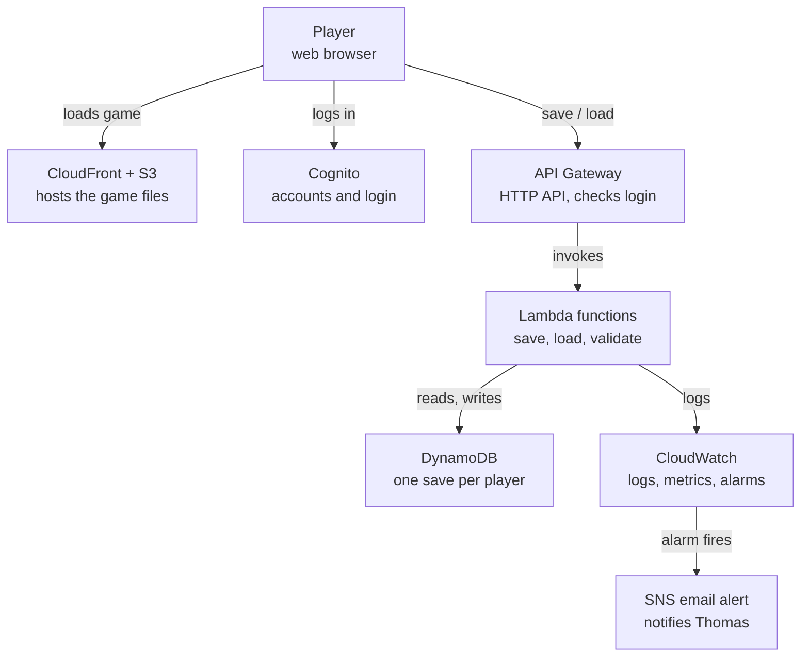

# Idle Game on AWS — PRD (Draft)

_Last updated: 2026-11-05 · Author: Thomas_

## Overview

A minimal browser-based idle game, shipped live on AWS, built to practice real cloud operations. The game mechanics are intentionally simple; the effort goes into infrastructure, automation, monitoring, and running a live service for a small group of real players.

- **Owner / engineer:** Thomas
- **PM / reviewer:** Justin
- **Status:** Draft for review

## Goals

### Personal goals

1. Close my scripting gap by writing my own Bash and Python operations scripts.
2. Get hands-on monitoring and alerting experience on a live system.
3. Apply my AWS Solutions Architect certification to a real build.
4. Produce a presentable project, with real incidents and decisions, that bridges my employment gap in interviews.

### Project goals

1. Ship a small idle game to a public URL, not just a local prototype.
2. Provide account-based online saves so progress follows a player across devices.
3. Manage all infrastructure as code with Terraform so it is documented, reviewable, and redeployable.
4. Run on a mostly serverless backend to keep cost near zero for a very small player base.
5. Operate it like a real service: monitoring, alerts, automated deployments, and documented incidents.

## Non-goals

These are out of scope so they can't quietly eat the timeline:

- Deep game design, balancing, art, or sound.
- Mobile apps; the game runs in a web browser only.
- Multiplayer or real-time interaction between players.
- Scaling beyond a handful of players.
- Monetization of any kind.

## Users and use cases

Expected users: about 3 players (friends), playing a few days a week. The service stays deployed 24/7.

| User | Wants to | Why it matters |
| --- | --- | --- |
| Player | Create an account and log in | Saves are tied to an identity |
| Player | Leave the game and return later to find offline progress added | Core idle-game loop |
| Player | Continue the same save on another device | Proves online saves work |
| Player (stretch) | See how they rank against other players | Leaderboard |
| Operator (Thomas) | Get alerted when something breaks, and find the cause in logs | Operations practice |

## Functional requirements

### MVP (must have)

1. **Core loop:** one resource that increases over time, plus one purchasable upgrade that increases the rate.
2. **Offline progress:** on login, the game calculates resources earned while away from the last saved timestamp. No background job updates players.
3. **Accounts:** players sign up and log in; each save is tied to one account.
4. **Online saves:** the game saves progress to the backend automatically at a fixed interval and on exit, and loads it on login.
5. **Cross-device:** logging in on a second device loads the same save.
6. **Basic validation:** the backend rejects impossible saves (for example, more resources than the elapsed time allows).

### Stretch (only after MVP is live)

1. **Leaderboard:** players see a ranking by total resources earned.
2. **Release notes page:** player-facing notes for each tagged release.

## Non-functional requirements

| Area | Requirement |
| --- | --- |
| Cost | Under $5/month total, enforced by an AWS Budgets alert at $5 |
| Security | Players can read and write only their own save; IAM roles follow least privilege; no secrets in the repo |
| Reliability | Saves are never lost; DynamoDB point-in-time recovery or regular backups enabled |
| Observability | Errors, latency, and missing data are visible in CloudWatch and trigger alerts |
| Reproducibility | The whole environment can be destroyed and rebuilt from Terraform and the pipeline alone |
| Performance | Save and load requests complete in under 1 second for normal use |

## Proposed architecture

_Terraform defines all of it; GitHub Actions deploys on version tags._

The game is static files served from S3 through CloudFront; everything that changes (accounts and saves) goes through one API. API Gateway and Cognito are proposals, not decisions; see Open questions.

**Why these choices**

- **Serverless:** pay per use, so being deployed 24/7 costs near zero with 3 players, and there are no servers to patch.
- **DynamoDB:** a save is one record per player, a simple key lookup; its always-free allowance covers this scale.
- **Terraform:** infrastructure is repeatable, reviewable in Git, previewed with `plan` before changes, and fully disposable with `destroy`.

## Operations

### Monitoring and alerting

- CloudWatch alarms for Lambda errors, API 5xx responses, and high latency, notifying by email through SNS.
- An alarm that treats missing data as a failure, so silence is caught, not ignored.
- Log retention set to 7–14 days to control cost.

### My own scripts (written without AI first)

- Bash health check that calls the API and logs failures.
- Bash or Python log analysis that counts and summarizes errors over a time window.
- Python (boto3) script that pulls key CloudWatch metrics into a short daily report.

### CI/CD and releases

- One branch per feature, merged into main through a pull request.
- GitHub Actions runs tests and `terraform plan` on every pull request.
- Deployment runs only when a version tag is pushed (`v0.1.0`, `v0.2.0`, and so on).
- Each release gets short player-facing notes on GitHub Releases.

### Incident practice

- Deliberately break components (bad permissions, a failing function, a broken deploy) and record what alerted, what the logs showed, and the fix.
- Keep a build log of every real issue: two lines each, problem and fix.

## Milestones

Each milestone is a tagged release reviewed with Justin before the next starts. Target dates are open (see Open questions).

1. **v0.1.0 — Playable locally:** core loop and offline progress work in the browser with a local save.
2. **v0.2.0 — Infrastructure live:** Terraform deploys the frontend and an API that returns a health check; the pipeline deploys on tag.
3. **v0.3.0 — Accounts and online saves:** sign-up, login, save, load, and cross-device play work end to end.
4. **v0.4.0 — Operated:** alarms, budget alert, and my own health-check and log-analysis scripts are in place.
5. **v0.5.0 — Proven:** at least two deliberate breaks detected and fixed, documented in the build log; friends playing.
6. **v1.0.0 — Done:** full teardown and rebuild from scratch without AI help; README with architecture, decisions, incidents, and monthly cost.
7. **Stretch:** leaderboard.

## Constraints and risks

**Constraints**

- Time: about 2 hours per weekday, alongside the job search.
- Budget: under $5/month.
- A relocation in late November or December may interrupt work for a week or more.
- AI is used as a tutor for infrastructure, scripts, and backend logic; it may generate the game's front end.

**Risks**

| Risk | Mitigation |
| --- | --- |
| Scope creep into game design | Game logic frozen at one resource and one upgrade until v1.0.0 |
| Surprise AWS charges (NAT Gateway, on-demand tables, verbose logs) | No VPC for Lambdas, provisioned DynamoDB, short log retention, $5 budget alert |
| AI writes code I can't explain | Write first, AI reviews; every component explained in the README |
| Losing momentum during the move | Milestones small enough to finish in about a week each |
| Players cheating saves | Server-side validation against elapsed time |

## Definition of done

The project is done when every item below is true:

- [ ] Live at a public URL, with at least 3 real players having used it.
- [ ] All MVP requirements work end to end.
- [ ] Monitoring and alerts have fired at least once in a deliberate test and were resolved.
- [ ] Monthly cost stays under $5.
- [ ] I can tear the environment down and rebuild it from scratch without AI help.
- [ ] I can explain every component and every decision without notes.
- [ ] README includes the architecture diagram, key decisions and tradeoffs, incidents, and monthly cost.

## Open questions

These are my decisions to make, and the places Justin will likely push:

- [ ] Target date for each milestone, given the move?
- [ ] Login: Amazon Cognito, or something simpler for 3 players? Why?
- [ ] API layer: API Gateway (HTTP API) or Lambda Function URLs? Why?
- [ ] Backend language: Go (reuse from Cloud-Project) or Python (practice for scripting)?
- [ ] How often does the game auto-save, and what happens if two devices save at once?
- [ ] Custom domain, or the default AWS URL to save cost?
- [ ] Why serverless here instead of reusing the ECS setup from Cloud-Project?
- [ ] Is the leaderboard worth it, and who is it for?
